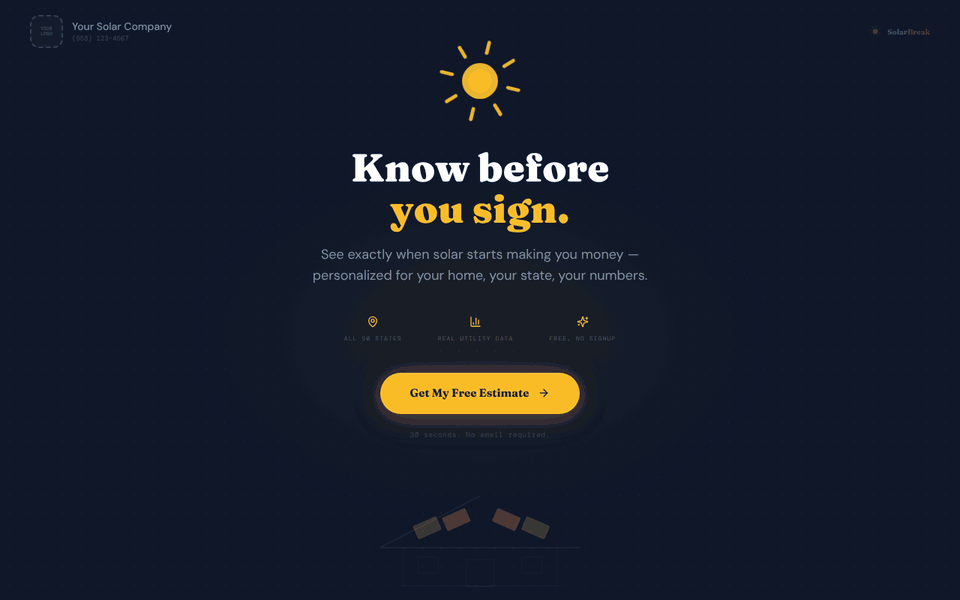

# SolarBreak



**Know before you sign. See exactly when solar starts paying for itself.**

Enter your monthly electric bill and your state, and SolarBreak sizes a system for your home, prices it,
and shows the year it breaks even: what you pay now, what you'd pay with solar, and what you keep over
25 years. It's built as a white-label tool a solar installer could put their own logo and phone number on.
It's the "Solar ROI" project on my profile.

Created by **Mike Warren** ([@dinosaurmike](https://github.com/dinosaurmike)).

**Try it: <https://dinomike.ca/solar/>**

---

## What it does

**A 30-second estimate**
- Two questions to start: your monthly electric bill and your state. All 50 states have their own sun
  hours and electricity rates.
- It sizes the system (kW and number of panels), estimates the installed cost and gives a verdict, from
  "Excellent solar investment" to "Difficult to justify financially".
- Monthly impact (your bill without and with solar) and the 25-year total cost of each.

**Compare the options**
- **Cash or loan**, with or without a **home battery**: four scenarios side by side, each with its
  break-even year, net cost, 25-year savings and monthly payment.
- **Payback charts:** cumulative savings against system cost (with the break-even year marked), annual
  cash flow, and utility bills with and without solar.
- Incentives: state or utility rebates, and the 30% federal tax credit for systems installed before 2026.
- **Got a quote?** Enter an installer's price and system size to check it.
- **Pro mode** shows every assumption: electricity rate and yearly increase, cost per watt, sun hours,
  net metering, panel degradation, loan terms and the analysis period.

**Take it with you**
- **Download a PDF proposal**, email the estimate, or **copy a share link** that reopens the same numbers.
- No signup and nothing stored: the estimate lives in the page (and in the link, if you share it).

> SolarBreak gives estimates for comparison. Real costs and savings depend on your installer, utility,
> roof and permits: get a formal proposal from a licensed solar installer.

## How it's built

- A **Next.js** (App Router) app in **React**, styled with **Tailwind CSS**, with **Recharts** for the charts and **jsPDF** for the proposal. Fonts: Fraunces,
  DM Sans and DM Mono.
- Exported as a **static site**: no server and no database. The whole calculation (sizing, cost,
  incentives, loan amortization, degradation and rate increases year by year) runs in the browser.
- A share link is the estimate's inputs, encoded in the URL.
- Built with Claude Code as a coding partner.

### What's in this repository

```
index.html, calculator/   the built app (Next.js static export; it expects to be served at /solar/)
_next/                    the app's JavaScript, CSS and fonts
og-image.png, favicon.svg link preview image and icon
classic/solar.html        the original one-page version (live at dinomike.ca/solar.html)
docs/images/              README header (GIF) and social preview, with the scripts that make them (source/)
```

This is the **built** app, ready to host. The original source project isn't included here yet.

To run it locally, serve it so it answers at `/solar/`:

```bash
mkdir -p ../site && ln -s "$PWD" ../site/solar
cd ../site && python3 -m http.server 8000
# open http://localhost:8000/solar/
```

## License

© 2026 Mike Warren. All rights reserved. The code is shared here so you can see the work; it isn't
licensed for reuse. See [LICENSE](LICENSE). The libraries and fonts inside the build keep their own
licences.
